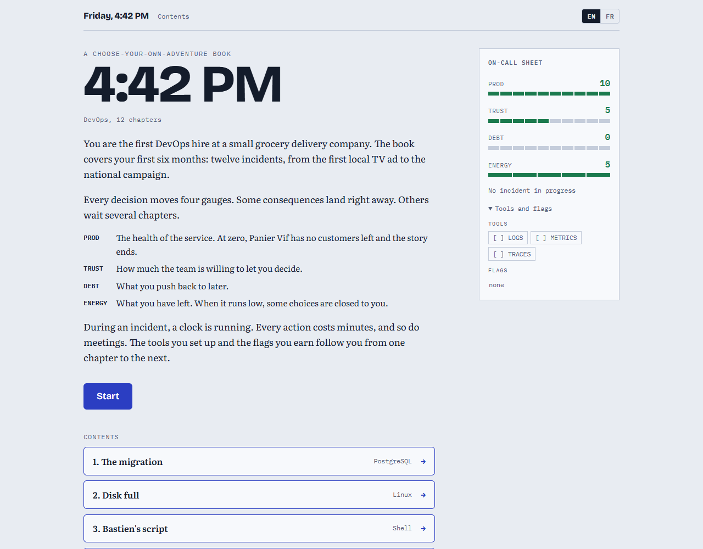
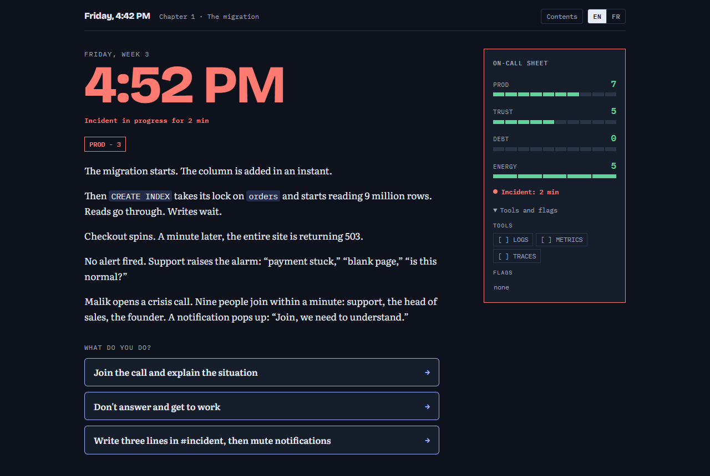
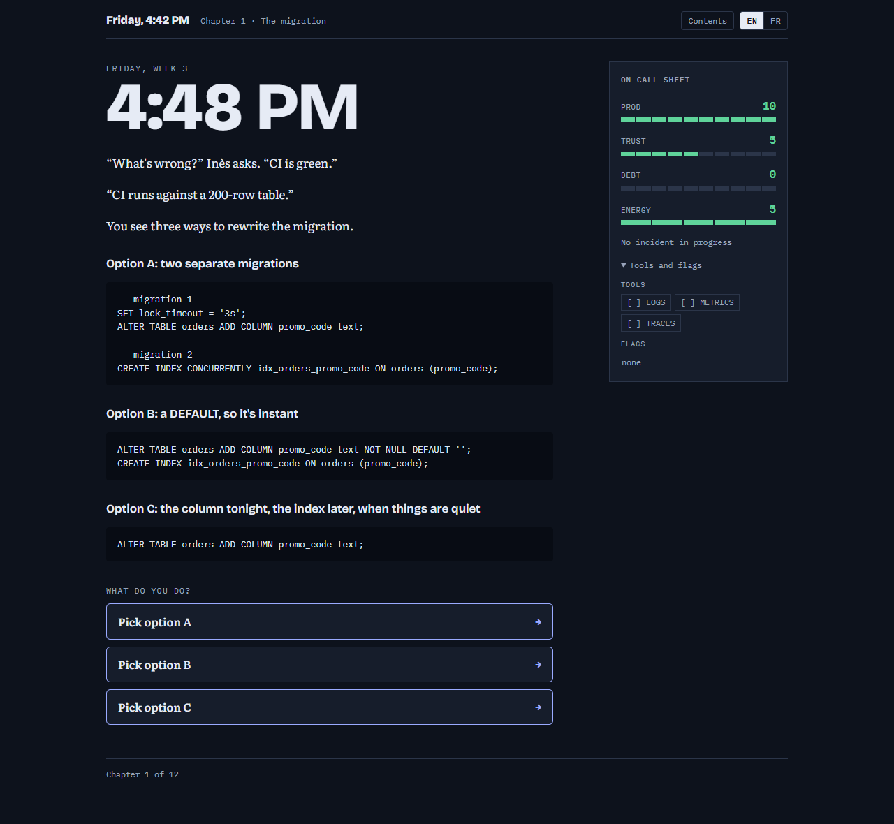
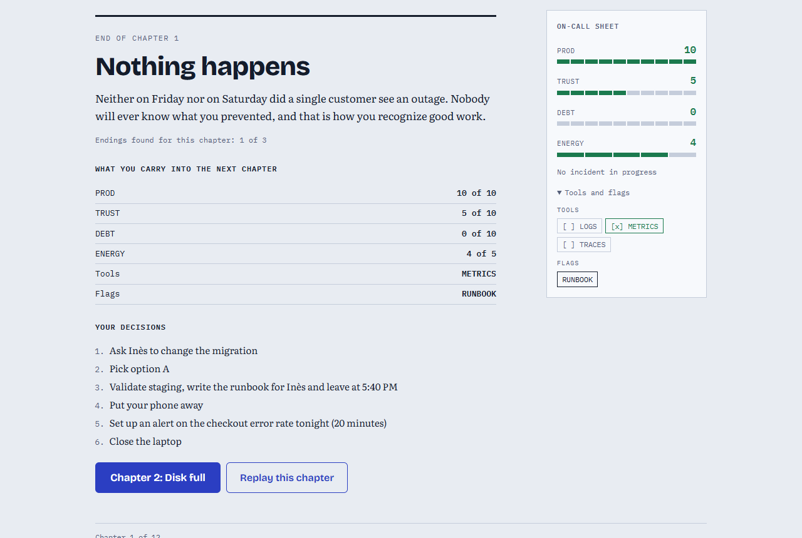
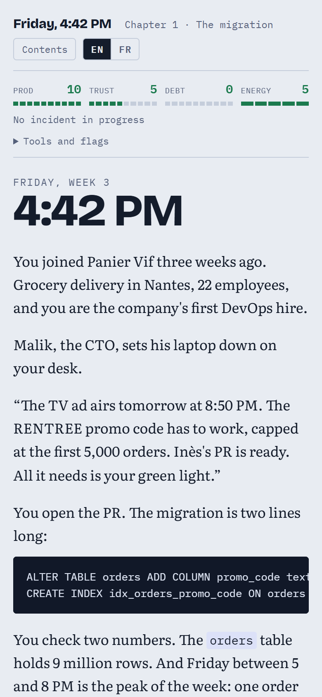

# Friday, 4:42 PM

A DevOps choose-your-own-adventure gamebook, in English and French (*Vendredi, 16 h 42*). A FR/EN switch in the top bar changes the language at any point, even mid-chapter; English is the default. You are the first DevOps hire at a small grocery delivery company, and you live through twelve incidents over six months: PostgreSQL, Linux, shell, backups, Docker, CI/CD, Python, Kubernetes, DNS/TLS, on-call, Terraform, and a national TV campaign.

Each choice moves four gauges (PROD, TRUST, DEBT, ENERGY). Flags and tools carry over from one chapter to the next, so a shortcut taken in chapter 3 can come back in chapter 11.

**Play:** https://underscorelog.github.io/devops-gamebook/

## Screenshots

| Home and table of contents | Incident in progress (dark theme) |
|---|---|
|  |  |
| **Choices with real configs** | **End of chapter** |
|  |  |



Screenshots are generated by `node outils/captures.js [url]` (headless Edge or Chrome).

## Layout

| Path | Content |
|------|---------|
| `site/chapitre-N.js` | The French story, one file per chapter (paragraphs, choices, effects, endings) |
| `site/en/chapter-N.js` | The English story, same structure, node for node |
| `site/moteur.js` | Game engine: state, effects, chapter chaining, rendering, interface text in both languages |
| `site/commun.js` | Helpers shared by chapters, book intro |
| `site/style.css` | Styles |
| `outils/simuler.js` | Walks every path of every chapter in both languages; fails on broken links, dead ends, unreachable paragraphs or endings, em dashes, or any FR/EN difference in paths and outcomes |
| `outils/assembler.js` | Builds `jeu.html`, a single self-contained file |
| `outils/servir.js` | Local server on http://localhost:4642 |
| `plan-du-livre.md`, `roadmap.md` | Book plan and writing roadmap |

## Commands

```bash
node outils/simuler.js        # check all chapters (or: node outils/simuler.js 4)
node outils/assembler.js      # build jeu.html
node outils/servir.js         # play locally
```

Every push to `main` runs the simulation, builds the game and deploys it to GitHub Pages.

## Status

First complete draft. Commands and outputs shown in the story have not been run in a lab yet, and no chapter has been reviewed by a specialist or playtested.
